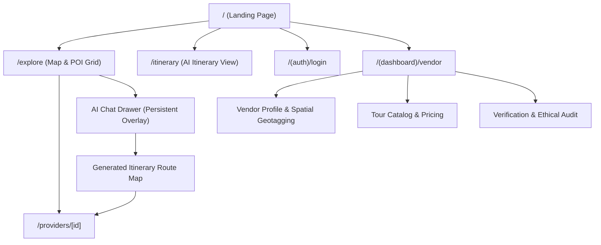

# Tourist Burma 2.0: System Design & UI/UX Specification

**Version:** 2.0.0  
**Status:** Approved / Design Ready  
**Target Platform:** Web / Mobile PWA (Responsive)  
**Companion Architecture:** `tourist_burma_2_0_architectural_vision.md`  
**Target Audience:** Frontend Engineers, UI/UX Designers, Product Managers, Spatial Data Engineers

---

## 1. Executive Summary & Design Vision

**Tourist Burma 2.0** is an AI-native, spatial travel intelligence platform engineered to revolutionize cultural and eco-conscious travel in Myanmar. Moving beyond static directory listings and commercialized tourism traps, Tourist Burma 2.0 pairs **real-time spatial querying (PostGIS)** with **generative conversational intelligence (Google Gemini 1.5 Pro + Vercel AI SDK)** to deliver bespoke, culturally authentic, and ethically vetted itineraries.

### 1.1 Core Design Pillars

1. **Spatial-First Discovery:** Geolocation and interactive cartography form the primary navigation paradigm. Travel is inherently spatial; itineraries, Points of Interest (POIs), and local artisans are discovered visually on high-performance vector maps.
2. **Culturally Conscious AI:** The AI concierge is not a generic chatbot. It is explicitly tuned to promote sustainable local businesses, respect regional customs, provide real-time cultural etiquette, and avoid exploitative or unethical tour operators.
3. **Resilience & Field-Readiness:** Designed for travelers exploring varied connectivity environments in Southeast Asia, the UI utilizes Progressive Web App (PWA) caching, optimistic updates, and lightweight client bundles.
4. **Burmese Heritage Aesthetics with Modernist Utility:** Visual design honors Myanmar’s rich architectural and artisanal heritage—teak wood, Bagan brick terracotta, lacquerware cinnabar, and Inle Lake tranquil azures—packaged in a clean, minimalist, high-contrast digital interface.

---

## 2. Design System & Visual Identity

### 2.1 Color Palette & Token System

The design system bridges traditional Burmese aesthetics with modern WCAG AAA compliant interface design.

| Token Name | Hex Code | Semantic Role | Cultural / Physical Inspiration |
| :--- | :--- | :--- | :--- |
| `--color-heritage-gold` | `#D4AF37` | Primary Accent / Highlights | Shwedagon Pagoda gold leaf & brass handicrafts |
| `--color-bagan-terracotta`| `#C85A32` | Secondary Action / Badges | Ancient red-brick stupas of Bagan |
| `--color-teak-900` | `#1F1610` | Primary Dark Surface / Text | Myanmar seasoned teak timber |
| `--color-teak-800` | `#2D2119` | Surface Elevated (Cards, Modals) | Handcrafted teak wood furniture |
| `--color-inle-azure` | `#2A7F9E` | Informational / Spatial Polylines | Inle Lake morning waters |
| `--color-shan-jade` | `#2E7D5B` | Verified Vendor / Eco Badge | Jade mines of Kachin & Shan highland pine forests |
| `--color-sand-50` | `#FDFBF7` | Light Mode Background / Canvas | Raw Thanaka bark & Shan mulberry paper |
| `--color-sand-100` | `#F4EFE6` | Light Mode Card Muted Surface | Unbleached organic cotton / Monk robe linen |
| `--color-border-subtle` | `rgba(212, 175, 55, 0.15)`| Delicate Dividers | Gilded lacquerware filigree |

### 2.2 Typography Hierarchy

Tourist Burma 2.0 supports dual-language typography (English and Myanmar Unicode) with seamless fallback and optical alignment:

* **Primary Display Font (Headers / Hero):** `Cinzel` or `Plus Jakarta Sans` (Weight: 600, 700) for a dignified, modern architectural tone.
* **Interface & Body Font:** `Inter` or `Plus Jakarta Sans` (Weight: 400, 500, 600) with dynamic letter-spacing for crisp legibility on mobile screens.
* **Myanmar Native Font Stack:** `Pyidaungsu`, `Noto Sans Myanmar`, `Padauk` fallback for localized text, ensuring zero broken rendering of complex Burmese ligatures.
* **Monospace / Technical Data:** `JetBrains Mono` for coordinates, route elevations, and timestamp displays.

```css
/* Typography Scale Tokens */
--text-xs: clamp(0.75rem, 0.7rem + 0.25vw, 0.8125rem);    /* 12-13px: Coordinates, Badges */
--text-sm: clamp(0.875rem, 0.825rem + 0.25vw, 0.9375rem); /* 14-15px: Secondary UI, Filters */
--text-base: clamp(1rem, 0.95rem + 0.25vw, 1.0625rem);    /* 16-17px: Body Prose, Chat */
--text-lg: clamp(1.125rem, 1.05rem + 0.35vw, 1.25rem);   /* 18-20px: Card Titles */
--text-xl: clamp(1.35rem, 1.2rem + 0.6vw, 1.65rem);      /* 22-26px: Section Headers */
--text-2xl: clamp(1.75rem, 1.5rem + 1.0vw, 2.25rem);     /* 28-36px: Page Titles */
--text-hero: clamp(2.25rem, 1.8rem + 2.0vw, 3.75rem);    /* 36-60px: Hero Headline */
```

### 2.3 Iconography & Badging System

The platform uses custom SVG micro-icons (20x20px and 24x24px grid) inspired by clean geometric lines:
- **Verified Provider Badge:** Golden lotus shield (`ShieldCheck` with `--color-shan-jade` glow).
- **Category Indicators:**
  - `ECO_LODGE`: Bamboo canopy & leaf motif.
  - `LOCAL_GUIDE`: Compass & Thanaka-stamped face silhouette.
  - `ARTISAN`: Traditional lacquer bowl & carving chisel.
  - `SUSTAINABLE_TRANSPORT`: Electric e-bike, traditional Inle long-tail rowboat, or horse cart icon.
- **Cultural Etiquette Warning:** Amber stupa icon indicating modest dress codes or holy precinct guidelines.

---

## 3. Information Architecture & Navigation

The platform organizes user journeys into three complementary pathways:
1. **Interactive Spatial Exploration (`/explore`):** Visual discovery via responsive vector maps, spatial search, and category filtering.
2. **Generative Concierge (`/api/chat` + AI Drawer):** Dynamic multi-day itinerary synthesis with contextual reasoning.
3. **Verified Vendor Ecosystem (`/dashboard/vendor` & `/providers/[id]`):** Community onboarding, heritage compliance verification, and direct traveler booking.

### 3.1 Sitemap & Route Hierarchy



---

## 4. Screen Layouts & Detailed UI Specifications

### 4.1 Global Navigation & Header (`components/ui/Header.tsx`)

* **Height:** 64px (Desktop), 56px (Mobile).
* **Position:** Fixed top, backdrop-blur (`bg-teak-900/80 backdrop-blur-md border-b border-border-subtle`).
* **Left:** Brand Lockup (`Tourist Burma 2.0` with miniature gold pagoda spire mark).
* **Center (Desktop):** Route Links (`Explore Map`, `Curated Journeys`, `Community Artisans`, `About Us`).
* **Right:** 
  - Dual Currency Toggle (`USD ($)` / `MMK (Ks)`).
  - Quick Search Bar (`Cmd + K` or touch trigger).
  - AI Assistant Trigger Button (floating pill with animated glowing dot).
  - Vendor Portal Login / Avatar.

---

### 4.2 Split-Screen Exploration Interface (`app/explore/page.tsx`)

The core discovery view features an adaptive split layout. On mobile, it seamlessly converts to a bottom drawer / map layer paradigm.

#### Desktop Layout (Viewport width >= 1024px)
```
┌────────────────────────────────────────────────────────────────────────────────────────┐
│ [Header] Tourist Burma 2.0     Explore | Journeys | Artisans        [Ask AI ✦] [Login] │
├──────────────────────────────────────────┬─────────────────────────────────────────────┤
│ Left Panel: POI & Itinerary Feed (45%)   │ Right Panel: Maplibre / Mapbox Canvas (55%) │
│                                          │                                             │
│ ┌──────────────────────────────────────┐ │ ┌─────────────────────────────────────────┐ │
│ │ 🔍 Search "Bagan sunrise, Shan tea"  │ │ │ [ 📍 Layer Toggle: Eco / Guides / Craft] │ │
│ ├──────────────────────────────────────┤ │ │                                         │ │
│ │ Filters: [Near Me] [★ 4.8+] [Guides] │ │ │                 ● Bagan Stupa Zone      │ │
│ ├──────────────────────────────────────┤ │ │              (Cluster 42 POIs)          │ │
│ │ 34 Verified Cultural Experiences     │ │ │                                         │ │
│ │                                      │ │ │                     📍 U Min Lha Craft  │ │
│ │ ┌──────────────────────────────────┐ │ │ │                                         │ │
│ │ │ [Image] Minnanthu Village Weaving│ │ │ │       📍 Old Bagan Eco-Lodge            │ │
│ │ │ ★ 4.98 · Artisan Guild · 1.2 km  │ │ │ │                                         │ │
│ │ │ "Authentic lotus silk weaving"   │ │ │ │                                         │ │
│ │ │ $25 USD / workshop               │ │ │ │                                         │ │
│ │ └──────────────────────────────────┘ │ │ │                                         │ │
│ │ ┌──────────────────────────────────┐ │ │ │                                         │ │
│ │ │ [Image] E-Bike Heritage Circuit  │ │ │ │ [ Zoom Controls ]     [ Recenter GPS ]  │ │
│ │ │ ★ 5.0 · Sustainable Transport    │ │ │ └─────────────────────────────────────────┘ │
│ └──────────────────────────────────────┘ └─────────────────────────────────────────────┘
└────────────────────────────────────────────────────────────────────────────────────────┘
```

#### Mobile Layout (Viewport width < 1024px)
* **Full-screen Map Layer:** Interactive touch map with clustered custom pin markers.
* **Top Floating Bar:** Glassmorphism search input and quick-category scroll pills (`All`, `Eco-Lodges`, `Local Guides`, `Artisans`, `Transport`).
* **Bottom Sheet Drawer (`Framer Motion` Snap Points: 15% peek, 50% list, 90% full feed):**
  - **15% Peek:** Shows active selected POI card or "34 experiences nearby".
  - **50% Half Sheet:** Scrollable cards with instant map pan on card selection.
  - **90% Full Sheet:** Immersive gallery view with detailed reviews, certifications, and booking actions.

---

### 4.3 AI Travel Agent Interface (`components/ai/ChatWindow.tsx`)

The AI assistant lives as a responsive slide-over panel on desktop or an interactive modal sheet on mobile. It accepts multimodal natural language prompts and renders interactive, executable itinerary widgets.

#### Component Wireframe & Generative UI Elements

```
┌──────────────────────────────────────────────────────────────┐
│  Tourist Burma AI Concierge                      [Minimize] [✕] │
│  Culture & Sustainable Travel Specialist                      │
├──────────────────────────────────────────────────────────────┤
│                                                              │
│ [AI] Mingalaba! I can craft an authentic, eco-friendly       │
│      itinerary tailored to your pace. Where would you        │
│      like to begin?                                          │
│                                                              │
│ [User] I have 3 days in Bagan. I want to avoid diesel cars,  │
│        support women-led artisans, and catch authentic       │
│        sunsets without crowds.                               │
│                                                              │
│ [AI] Thinking... [Queried PostGIS: 4 Artisans, 2 Clean Routes] │
│                                                              │
│ ┌──────────────────────────────────────────────────────────┐ │
│ │ ✦ 3-Day Conscious Bagan Itinerary                        │ │
│ │                                                          │ │
│ │ DAY 1: Sacred Terracotta & Lotus Threads                 │ │
│ │ • 06:00 AM — Quiet Sunrise at Kyauk Gu Umin (E-Bike)     │ │
│ │ • 10:30 AM — Minnanthu Women's Cotton Cooperative        │ │
│ │   [Verified Artisan Badge] · 1.8km from Old Bagan        │ │
│ │ • 04:30 PM — Sunset Tea at Riverside Teak Pavilion       │ │
│ │                                                          │ │
│ │ [📍 View on Map]  [✦ Save Itinerary]  [Export to PDF]    │ │
│ └──────────────────────────────────────────────────────────┘ │
│                                                              │
│ "Would you like me to book a certified local guide for Day 1?"│
├──────────────────────────────────────────────────────────────┤
│ ┌──────────────────────────────────────────────────┐ [Send]  │
│ │ Ask about dress codes, local tips, or modify...  │  ▲      │
│ └──────────────────────────────────────────────────┘         │
└──────────────────────────────────────────────────────────────┘
```

#### Generative Itinerary Card Features (`components/ai/ItineraryCard.tsx`):
- **Live Spatial Sync:** Clicking `[📍 View on Map]` dispatches the coordinates to `MapView.tsx`, animating the map camera to frame all waypoint coordinates (`flyTo({ bounds, padding })`).
- **Provider Quick-Connect:** Waypoints directly link to verified local provider cards with upfront pricing and zero middleman markups.
- **Cultural Awareness Alert:** Embedded notes warning travelers of respectful practices (e.g., removing shoes and socks before temple boundary markers).

---

### 4.4 Vendor Dashboard & Verification Flow (`app/(dashboard)/vendor/page.tsx`)

The vendor interface empowers local guides, eco-lodges, and family artisans to manage their presence without needing deep digital expertise:

1. **Spatial Geotagging Widget:**
   - Visual map picker with GPS auto-detection to pin exact shop/departure coordinates with 6 decimal place precision (`SRID 4326`).
2. **Ethical Standard Onboarding Checklist:**
   - Certification upload (Community-Based Tourism accreditation, local guide license, eco-friendly waste management verification).
   - Fair wage & transparent pricing statement.
3. **Tour & Experience Builder:**
   - Interactive pricing calculator with instant currency conversion (`USD` / `MMK`).
   - Group size limits to prevent over-tourism in fragile heritage zones.

---

## 5. Interaction Design & Motion Architecture

All micro-interactions adhere to physical metaphors of smoothness, calm pacing, and high tactile feedback using **Framer Motion**:

### 5.1 Animation Constants

```typescript
export const MOTION_TRANSITIONS = {
  drawerSpring: {
    type: "spring",
    damping: 30,
    stiffness: 300,
  },
  cardHover: {
    scale: 1.02,
    y: -4,
    transition: { duration: 0.2, ease: "easeOut" },
  },
  mapMarkerPulse: {
    scale: [1, 1.25, 1],
    opacity: [0.8, 0.4, 0.8],
    transition: { repeat: Infinity, duration: 2.2, ease: "easeInOut" },
  },
  streamingCursor: {
    opacity: [0, 1, 0],
    transition: { repeat: Infinity, duration: 0.8 },
  },
};
```

### 5.2 Micro-Interactions
- **POI Card Hover -> Map Pin Synchronization:** Hovering over a vendor card in the left list activates the corresponding custom marker on the map with a glowing gold ring (`--color-heritage-gold`).
- **Map Marker Click -> Card Scroll:** Clicking a marker smoothly scrolls the list view to the target card and opens the bottom drawer.
- **Streaming Response Ingestion:** As `streamText` chunks stream via Vercel AI SDK, new markdown segments fade in with smooth height expansion (`framer-motion AnimatePresence`), preventing jarring layout shifts.

---

## 6. Spatial UI & Cartography Specification

### 6.1 Vector Tile Style & Basemap Theme
To maintain brand cohesion, the map canvas (`components/map/MapView.tsx`) uses a custom Mapbox / Maplibre style:
- **Base Palette:** Warm muted charcoal for dark mode (`#1A1715`), soft Shan parchment for light mode (`#EFECE6`).
- **Water Bodies (Irrawaddy, Inle, Andaman Sea):** Deep slate cyan (`#1F404D`).
- **Heritage & Forest Zones:** Subtle olive wash (`#242D26`) with transparent contours.
- **Road & Trail Networks:** Subtle sand strokes differentiating e-bike trails, walking paths, and main highways.

### 6.2 Marker Cluster Rules
To avoid visual clutter around dense heritage centers like Old Bagan and Mandalay Palace:
- **Zoom Level 0 - 9:** Country-level macro clusters showing regional counts (e.g., "Shan State · 84", "Mandalay · 120").
- **Zoom Level 10 - 14:** Micro-clusters with category pie chart indicators.
- **Zoom Level 15+:** Individual custom SVG pins displaying provider avatar, verified badge, and live price pill.

---

## 7. Responsive Breakpoint & Layout System

| Device Category | Breakpoint (px) | Navigation Pattern | Map vs. List Split | AI Chat Experience |
| :--- | :--- | :--- | :--- | :--- |
| **Mobile Portrait** | `< 640px` | Bottom Tab Bar (Explore, Saved, Chat, Profile) | 100% Map with Bottom Snap Sheet | Full-screen Slide-up Modal |
| **Mobile Landscape / Small Tablet** | `640px - 767px` | Collapsible Side Rail | 100% Map with Floating Card Carousel | Slide-over Drawer (380px) |
| **Tablet Portrait / Medium** | `768px - 1023px`| Fixed Top Header | 40% List / 60% Map | Slide-over Drawer (420px) |
| **Desktop** | `1024px - 1439px`| Full Header Navigation | 45% List / 55% Map | Embedded Floating Widget (440px) |
| **Ultra-Wide** | `>= 1440px` | Full Header + Spatial Metric Bar | 38% List / 62% Map | Docked Persistent Right Column |

---

## 8. Offline Resilience & Progressive Web App (PWA) Design

Given fluctuating bandwidth across Myanmar's rural travel corridors, the platform is engineered for graceful offline degradation:

1. **Vector Map Tile Caching:**
   - Pre-caching of vector tiles for selected tour regions (e.g., Bagan Archaeological Zone, Inle Lake Basin) into CacheStorage.
2. **Offline Itinerary Vault:**
   - Saved AI itineraries, provider contact numbers, and offline GPS route coordinates persist in **IndexedDB** via `idb-keyval`.
3. **Connectivity Indicator Banner:**
   - Non-intrusive amber pill at the top of the interface: *"Operating in Offline Field Mode. Saved itineraries and cached maps available."*
4. **Optimistic UI:**
   - Favoriting providers, saving routes, and noting checkpoints execute optimistically and sync with the backend once connectivity resumes.

---

## 9. Accessibility (a11y) & Ethical Design Standards

### 9.1 Inclusive Design Requirements
- **Keyboard Navigation:** Full focus-ring support across the split-screen view (`Tab` cycling through cards, `Enter` to focus map marker, `Escape` to close drawers).
- **Screen Reader Announcements:** ARIA live regions (`aria-live="polite"`) configured for streaming AI text responses and spatial query result count changes.
- **Contrast Ratios:** All text elements exceed WCAG 2.1 AA standards (minimum 4.5:1 for body copy, 3:1 for large display titles).

### 9.2 Ethical & Anti-Exploitation Safeguards
- **Zero Predatory Commercial Traps:** The system excludes unverified commercial operators, captive wildlife attractions, or souvenir shops with forced shopping quotas.
- **Community-First Benefit Transparency:** Each provider page features a "Community Impact Scorecard" displaying direct economic benefit to local households (e.g., *100% Locally Owned*, *Fair Living Wage Certified*).
- **Cultural Respect Warnings:** Dynamic contextual notifications display dress codes, photography etiquette, and sacred boundary reminders before travelers arrive at sensitive religious sites.

---

## 10. Implementation Plan & Component Checklist

```text
components/
├── ai/
│   ├── ChatWindow.tsx             [ ] Natural language streaming chat interface
│   ├── ChatMessageBubble.tsx      [ ] Formatted markdown + AI persona avatar
│   ├── ItineraryCard.tsx          [ ] Structured multi-day route widget
│   └── PromptSuggestions.tsx      [ ] Contextual quick-prompts for travelers
├── map/
│   ├── MapView.tsx                [ ] Mapbox / Maplibre GL canvas container
│   ├── CustomMarker.tsx           [ ] Categorized SVG pin with verification badge
│   ├── RoutePolyline.tsx          [ ] GeoJSON route layer for multi-stop itineraries
│   └── MapControls.tsx            [ ] Zoom, pitch, GPS recenter, and layer toggles
├── explore/
│   ├── POICard.tsx                [ ] Verified vendor card with imagery and pricing
│   ├── POIFilterBar.tsx           [ ] Category pills, radius slider, rating filter
│   └── SplitLayout.tsx            [ ] Responsive desktop split / mobile sheet container
├── vendor/
│   ├── GeotagPicker.tsx           [ ] Pinpoint coordinate picker with PostGIS validation
│   └── VerificationBadgeForm.tsx  [ ] Accreditation and community audit upload
└── ui/
    ├── Header.tsx                 [ ] Fixed responsive header with dual currency
    ├── Button.tsx                 [ ] Burmese gold / teak styled action button
    ├── Drawer.tsx                 [ ] Framer Motion snap-point bottom drawer
    └── StatusBanner.tsx           [ ] Connectivity and cultural etiquette warnings
```

---

## 11. Conclusion & Next Steps

This design specification forms the blueprint for Tourist Burma 2.0. By coupling high-precision spatial cartography with culturally conscious generative intelligence, Tourist Burma 2.0 provides an unprecedented travel platform that empowers travelers while honoring and sustaining the heritage and communities of Myanmar.
